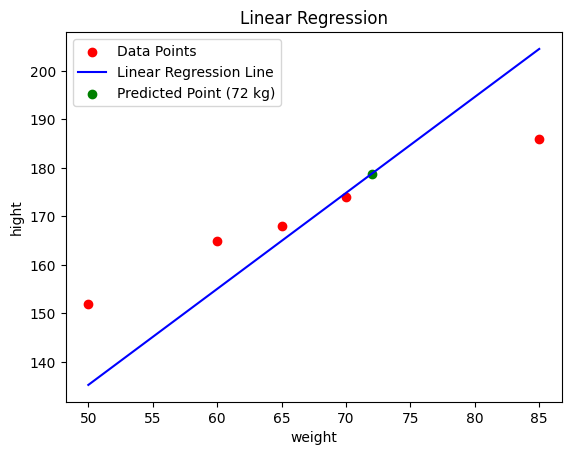
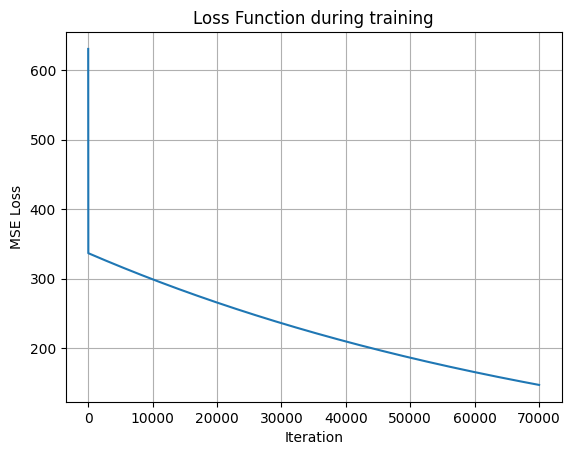

# 📈 Linear Regression From Scratch (Height vs Weight)

A **from-scratch Machine Learning notebook** that implements **Linear Regression using Gradient Descent** (no sklearn model training).  
Given a person’s **weight (kg)**, the notebook learns a line **y = mx + b** to predict **height (cm)** — and visualizes both the **regression fit** and the **loss curve** during training. ✅

---

## 🔗 Quick Access

[](https://github.com/moalawfi/gradient-descent-from-scratch)

---

## 📸 Preview

<p align="center">
  
  
</p>
<p align="center"><sub>Learned regression line · MSE loss during training</sub></p>

---

## 🎓 Why Implement Linear Regression From Scratch?

Implementing Linear Regression from scratch is valuable academically because it transforms the model from a **black-box tool** into a **fully understood algorithm**. Instead of calling a library function, we explicitly define the **loss function (MSE)**, compute the **gradients**, and apply **gradient descent** updates. This builds strong intuition about **how learning happens**, how parameters converge, and why choices like the **learning rate** and **feature scaling** affect performance.  

Most importantly, this foundation generalizes to more advanced ML methods (e.g., **logistic regression** and **neural networks**), where training also relies on the same optimization principles.
---
## 🧠 How It Works

### 1) Dataset
The notebook reads a CSV file containing two columns:
- **Input feature:** `Weight (kg)`
- **Target label:** `Height (cm)`

Expected file name/path in Colab:
- `/content/hight_weight.csv`

> If your file name is `height_weight.csv`, either rename it or update the path in the notebook.

---

### 2) Core Equation
We learn a straight line:

- **Model:** `y = m*x + b`  
  - `m` = slope  
  - `b` = intercept

A simple `predict(x, m, b)` function computes outputs.

---

### 3) Training (Gradient Descent)
Instead of using a ready-made ML library, the notebook computes:
- **MSE Loss**
- **Gradients (dm, db)**
- **Parameter updates** using a learning rate

Training runs for a large number of iterations until the loss stabilizes.

---

### 4) Output & Visualization
The notebook includes:
- ✅ A prediction example: **height at 72 kg**
- 📌 A scatter plot of the dataset + the learned regression line
- 📉 A loss curve showing **MSE vs iteration**

---

## ✨ Features

- Linear Regression implemented from scratch (no model APIs)
- Clean step-by-step functions:
  - `predict()`
  - `mse()`
  - `gradients()`
  - `gd_step()`
  - `gradient_descent()`
- Visualizes both **fit** and **training progress**
- Includes a real numeric prediction example (72 kg)

---

## 🛠️ Tech Stack

[](#)
[](#)
[](#)
[](#)

---

## 📂 Project Structure

```txt
├── Implementing_Linear_Regression_From_Scratch.ipynb
├── hight_weight.csv                      # dataset (add it here)
├── assets/
│   └── preview.png                       # optional screenshot
├── requirements.txt                      # recommended
└── README.md
````

---

## ⚙️ Run Locally

### 1) Install Requirements

```bash
pip install numpy pandas matplotlib
```

(Optional) create a `requirements.txt`:

```txt
numpy
pandas
matplotlib
```

### 2) Add the Dataset

Place your CSV in the project folder:

* `hight_weight.csv`

Make sure it contains these columns exactly:

* `Weight (kg)`
* `Height (cm)`

### 3) Run the Notebook

```bash
jupyter notebook
```

Open:

* `Implementing_Linear_Regression_From_Scratch.ipynb`

---

## 🔍 Notes & Tips

* **Units matter:** weight must be in **kg**, height in **cm**.
* If training is slow, reduce `n_iters` or increase the learning rate carefully.
* If the loss is not decreasing, try:

  * smaller learning rate
  * feature scaling (normalize weight)

---

## 📌 Note About the Dataset File

If the dataset CSV is not included in this repository, and you want the exact file used, feel free to **contact me on LinkedIn** and I’ll share it with you.

[](https://www.linkedin.com/in/mohammed-a-3913a5378/)


---

## 🚀 Future Improvements

* Add **train/test split** and report test MSE
* Compare with **closed-form solution** (Normal Equation)
* Add **feature scaling** for faster convergence
* Save learned parameters (`m`, `b`) to a file for reuse
* Turn it into a small **Streamlit app** (input weight → predicted height)

---

## 🧑‍💻 Author

**Mohammed Alawfi**
📍 Madinah, Saudi Arabia

[](https://github.com/moalawfi)
[](https://www.linkedin.com/in/mohammed-a-3913a5378/)

---

## 📜 License

This project is licensed under the **MIT License**. See `LICENSE` for details.

```
```
